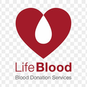
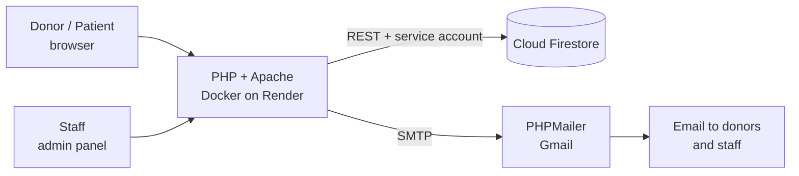

<div align="center">



# 🩸 Lifeline Blood Bank

**Donate blood. Find blood. Save lives.**

A full-stack blood bank and donor management platform where donors book appointments, patients raise emergency requests, and staff run stock, camps and requests from one admin panel.

[](https://lifeline-bloodbank-kkba.onrender.com)


[Features](#-features) · [How it works](#-how-it-works) · [Quick start](#-quick-start) · [Deploy](#%EF%B8%8F-deploy-on-render) · [Security](#-security)

</div>

---

## 🌟 Why Lifeline?

In an emergency, every minute counts. Lifeline puts everything in one place:

| 🧑 Donors | 🚑 Patients & families | 🏥 Blood bank staff |
|---|---|---|
| Register, book a slot, track donations | Search stock and raise an urgent request | Approve requests, manage stock, run camps |

## ✨ Features

### For donors and the public

| | Feature | What it does |
|---|---|---|
| 🩸 | **Donor registration** | Sign up with blood group, age and contact details |
| 📅 | **Appointments** | Book, change or cancel a donation slot |
| 🔎 | **Find blood** | Search availability by blood group and component |
| 🚨 | **Emergency requests** | Submit an urgent request; staff are alerted by email |
| 🏕️ | **Donation camps** | Browse upcoming camps |
| 👤 | **Donor dashboard** | Personal profile and donation history |
| 💬 | **Chat assistant** | Help bot on the home page |
| ✉️ | **Contact form** | Enquiries saved and emailed to staff |

### For staff (admin panel)

| | Feature | What it does |
|---|---|---|
| 📊 | **Dashboard & analytics** | Donors, requests and stock at a glance |
| 🧑‍🤝‍🧑 | **Donors** | View and manage registered donors |
| 📝 | **Requests & appointments** | Review, approve and track; donors are emailed on status changes |
| 📦 | **Inventory** | Stock by group and component (whole blood, packed RBC, plasma, platelets) with expiry dates |
| 📒 | **Blood ledger** | Every stock movement recorded for a daily stock report |
| 🏕️ | **Camps** | Create and manage donation camps |
| 🔐 | **Secure login** | Hashed passwords, login-attempt limiting, change-password |
| 🔔 | **Donation reminders** | Emails donors when they are eligible to give again |

## 🔄 How it works



## 🧱 Tech stack

| Layer | Technology |
|---|---|
| Backend | Plain PHP 8 (no framework) |
| Database | Google Cloud Firestore through a small built-in REST client (`bloodbank/firebase/Firestore.php`) that needs only `curl` and `openssl` |
| Email | [PHPMailer](https://github.com/PHPMailer/PHPMailer) via Composer |
| Hosting | Docker (`php:8.2-apache`) on Render, or XAMPP locally |

## 📁 Project structure

```
├── Dockerfile                    container for Render
├── render.yaml                   Render blueprint
├── service-account.example.json  template for your Firebase key
└── bloodbank/
    ├── index.php, about.php, contact.php     public pages
    ├── donate.php, donor*.php, login.php     donor sign-up, login, dashboard
    ├── request.php, find.php                 emergency requests, blood search
    ├── camp.php, camps_helper.php            donation camps
    ├── inventory*.php                        stock and daily report
    ├── admin_*.php                           admin panel
    ├── mailer.php, mail_config.php           email sending (no secrets inside)
    ├── db_connect.php                        Firestore connection
    ├── firebase/                             Firestore client, auth, seed and backup scripts
    └── FIRESTORE_SETUP.md                    detailed Firestore guide
```

## 🚀 Quick start

### 1. Requirements
- PHP 8+ with the `curl` and `openssl` extensions (XAMPP has both)
- A Google account with a Firebase project
- [Composer](https://getcomposer.org/) is optional; `vendor/` is included

### 2. Get the code
```bash
git clone https://github.com/snehasanu64/lifeline-bloodbank.git
```
Copy the project into your XAMPP `htdocs` folder.

### 3. Connect Firestore
1. In the Firebase Console, create a project and enable **Cloud Firestore**.
2. **Project settings → Service accounts → Generate new private key**.
3. Save it as `service-account.json` in the project root (see `service-account.example.json`). It is git-ignored; never commit it.
4. Lock the database down, since only this server talks to it:
   ```
   rules_version = '2';
   service cloud.firestore {
     match /databases/{database}/documents {
       match /{document=**} { allow read, write: if false; }
     }
   }
   ```

More detail: [`bloodbank/FIRESTORE_SETUP.md`](bloodbank/FIRESTORE_SETUP.md).

### 4. Load sample data (optional)
```bash
php bloodbank/firebase/seed_firestore.php       # donors, requests, appointments
php bloodbank/firebase/seed_blood_stock.php     # blood stock
php bloodbank/firebase/seed_blood_ledger.php    # stock ledger
php bloodbank/firebase/seed_dummy_admin.php     # demo data for the admin panel
```
The demo donors' password is `DEMO_DONOR_PASSWORD` if you set it, otherwise a random one printed when the script finishes.

### 5. Set up email (optional)
Copy `bloodbank/mail_config.local.example.php` to `bloodbank/mail_config.local.php` and fill in your Gmail address and an **App password** (Google Account → Security → 2-Step Verification → App passwords). Until then, emails are skipped and the site works normally.

### 6. Run it
Start Apache in XAMPP and open `http://localhost/bloodbank/`.

## ☁️ Deploy on Render

1. Sign in to [Render](https://render.com) with GitHub → **New → Blueprint** → pick this repo (it reads `render.yaml`).
2. In the service's **Environment** tab, set:

| Variable | Purpose |
|---|---|
| `FIREBASE_SERVICE_ACCOUNT_JSON` | Whole contents of your `service-account.json` |
| `MAIL_USERNAME` | Gmail address that sends mail |
| `MAIL_PASSWORD` | Gmail app password |
| `MAIL_ADMIN_EMAIL` | Inbox that receives enquiries and request alerts |
| `MAIL_CRON_KEY` | Secret for running the reminder script by URL (auto-generated) |
| `ADMIN_BOOTSTRAP_PASSWORD` | *(first run only)* creates the `admin` account; change it after logging in |
| `MAIL_HOST` / `MAIL_PORT` / `MAIL_SECURE` | *(optional)* override the SMTP server |

3. Deploy. The site is served from `bloodbank/`.

> ⚠️ **Free plan notes:** the service sleeps after inactivity, so the first visit can take about a minute. Render's free plan also blocks outbound SMTP ports, so Gmail email may not send until you upgrade or use an HTTPS email API.

## 🗄️ Firestore collections

`donors` · `admins` · `blood_requests` · `donation_appointments` · `blood_stock` · `inventory_transactions` · `blood_ledger` · `camps` · `contact_messages` · `login_attempts`

A legacy MySQL schema stays in `bloodbank/database_setup.sql` for reference; the app itself uses Firestore.

## 🔒 Security

- No secrets live in the repo. Credentials come from environment variables or git-ignored files (`service-account.json`, `mail_config.local.php`).
- Passwords are stored hashed, and admin login is rate-limited.
- Use a Gmail **App password**, never your real one, and rotate any key that has been shared.
- The `.htaccess` files block web access to `.json`, `.env`, `.log` and `.sql` files.
- Change the admin password straight after first login.

## 🤝 Contributing

Ideas and pull requests are welcome. Please open an issue first for big changes.

---

<div align="center">

Made with ❤️ to help people find blood when they need it most.

⭐ **Star the repo if it helps you!**

</div>
